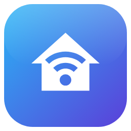
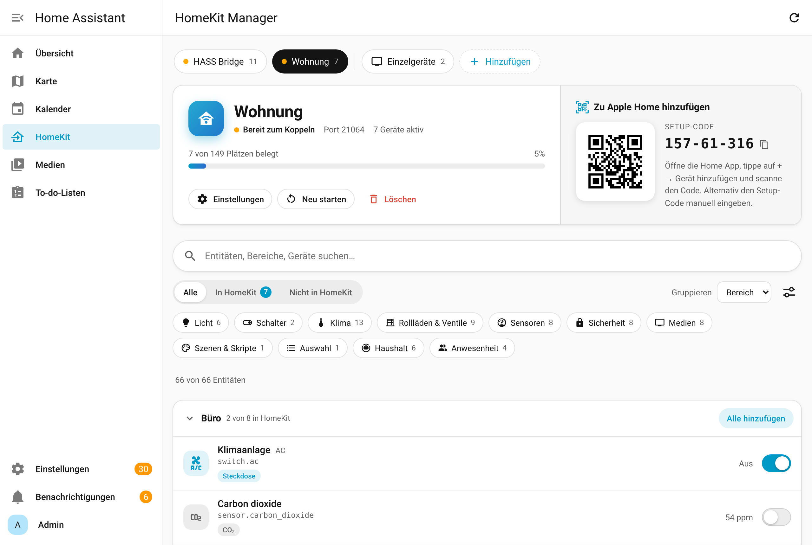
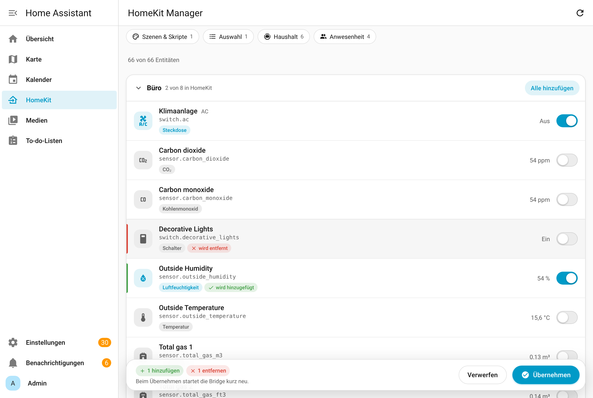
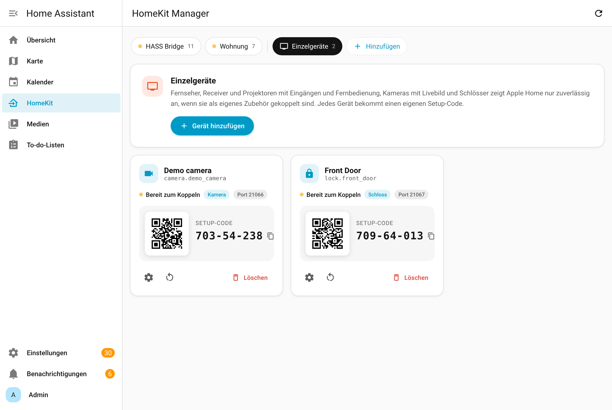
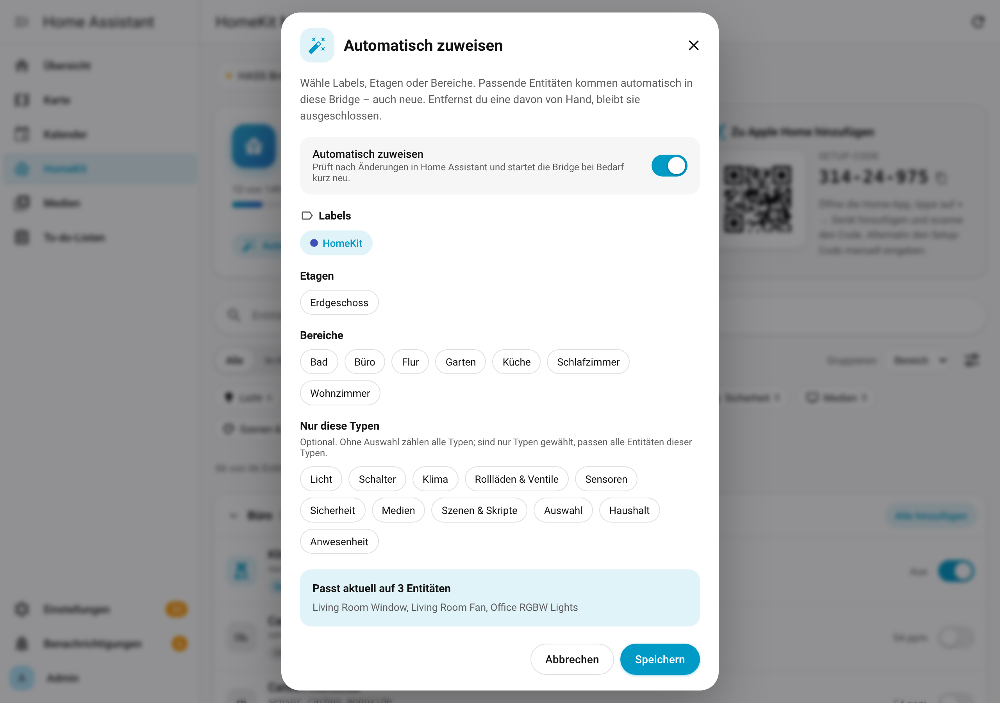
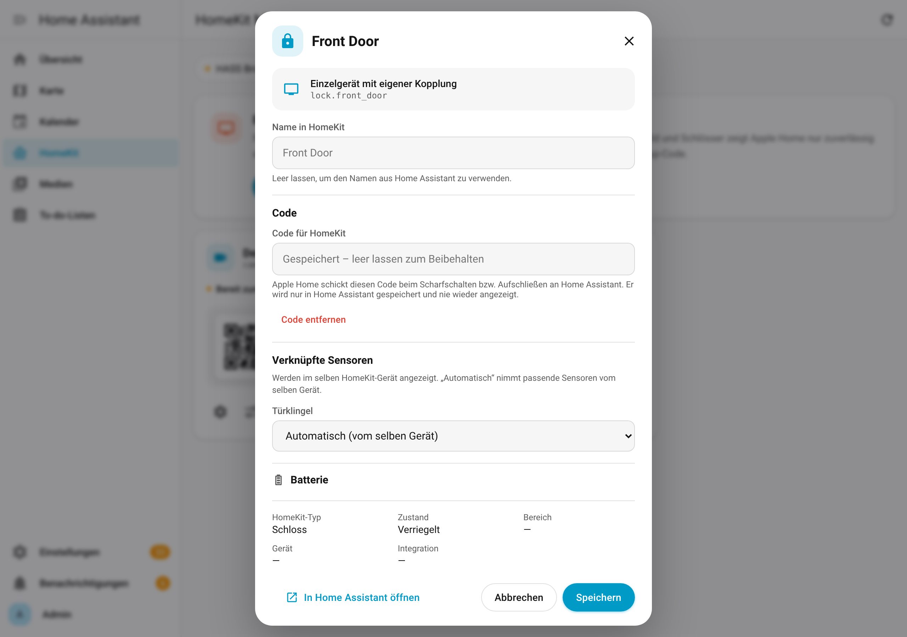
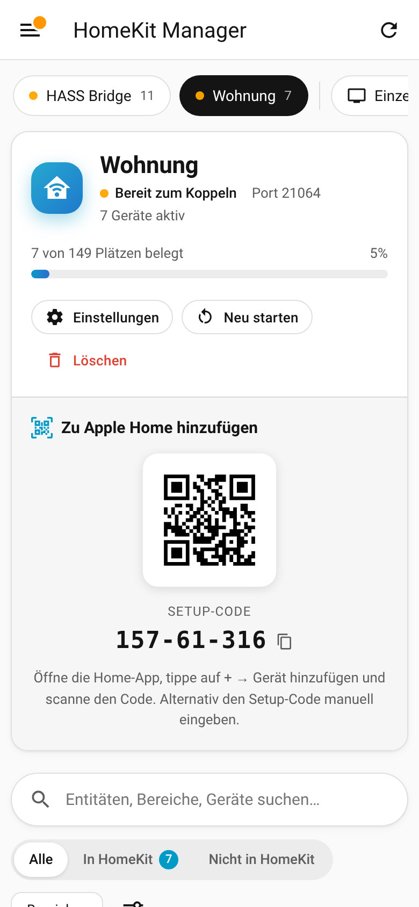
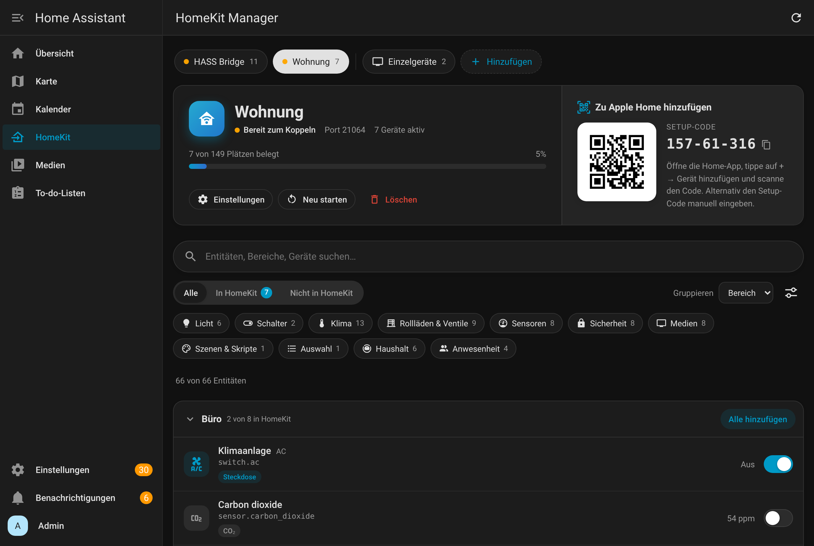

# HomeKit Manager

Home-Assistant-Integration für den Marketplace (früher HACS): legt HomeKit Bridges an und fügt der Seitenleiste eine **HomeKit**-Seite hinzu. Dort wählst du per Schalter aus, welche Entitäten an Apple Home durchgereicht werden – ohne YAML, ohne Domain-Filter. Fernseher, Kameras und Schlösser lassen sich zusätzlich als **Einzelgerät** mit eigenem Setup-Code koppeln.

| Entitäten zuweisen | Einzelgeräte (TV, Kamera, Schloss) |
|---|---|
|  |  |
|  |  |

## Funktionen

- **Bridge anlegen** beim Einrichten der Integration oder jederzeit im Panel; mehrere Bridges möglich.
- **Entitäten per Schalter zuweisen**, gruppiert nach Bereich oder Typ, mit Suche, Filtern und „Alle hinzufügen“ pro Gruppe. Änderungen werden gesammelt und mit einem Klick übernommen.
- **Automatisch zuweisen** per Label, Etage, Bereich und Typ: Neue passende Entitäten landen von selbst in der Bridge, von Hand entfernte bleiben ausgeschlossen.
- **Geräteoptionen** pro Entität: Name in HomeKit, Gerätetyp (z. B. Schalter → Steckdose/Ventil/Bewässerung, Ventilator → Luftreiniger, Klima → Thermostat/Heiz-/Kühlgerät), **verknüpfte Sensoren** (Batterie, Bewegung/Klingel an Kameras, Klingel an Schlössern, Luftfeuchte, Feinstaub, Filter, Hinderniserkennung), **Code** für Alarmanlage und Schloss, **Mediaplayer-Funktionen**.
- **Wartungsfrei:** Umbenannte Entitäts-IDs werden automatisch nachgezogen (das Gerät bleibt in Apple Home erhalten). Gelöschte Entitäten zeigt das Panel an und Home Assistant meldet sie unter *Reparaturen* mit Ein-Klick-Bereinigung.
- **Einzelgeräte** für Fernseher, Receiver, Projektoren, Kameras, Schlösser und Aktivitäts-Fernbedienungen – Apple Home unterstützt diese nur so vollständig. Beim Anlegen wird das Gerät auf Wunsch aus der Bridge entfernt.
- **Koppeln**: QR-Code und Setup-Code direkt im Panel, Kopplungsstatus live, Kopplung zurücksetzen, Neustart, Umbenennen, Port ändern, Löschen.
- **Bestehende Bridges übernehmen**, die mit dem HomeKit-Standarddialog (Domain-Filter) angelegt wurden.
- Zeigt an, welcher HomeKit-Typ entsteht und welche Entitäten HomeKit nicht unterstützt; 149-Geräte-Limit pro Bridge wird überwacht.
- Deutsch und Englisch, Hell-/Dunkelmodus und Mobilansicht, passt sich dem HA-Theme an.

Technisch nutzt HomeKit Manager die eingebaute **HomeKit-Bridge-Integration** von Home Assistant und verwaltet nur deren Konfiguration. Kopplung, Geräte-Typen und Kamera-Streaming laufen über den gepflegten Core-Code.

 

## Setup

Voraussetzung: Home Assistant **2026.2** oder neuer (getestet mit 2026.2, 2026.10, 2026.11).

**Marketplace (ab HA 2026.11):** Einstellungen → Marketplace → *Hinzufügen per Link* → `https://github.com/hxcde/HASS-HomeKit-Manager` → *HomeKit Manager* installieren.

**HACS (bis HA 2026.10):** HACS → ⋮ → *Benutzerdefinierte Repositories* → URL oben, Typ *Integration* → installieren → Home Assistant neu starten.

**Manuell:** Ordner `custom_components/homekit_manager` nach `<config>/custom_components/` kopieren und Home Assistant neu starten.

Danach: Einstellungen → Geräte & Dienste → *Integration hinzufügen* → **HomeKit Manager** ([direkt öffnen](https://my.home-assistant.io/redirect/config_flow_start/?domain=homekit_manager)). Namen der Bridge eingeben – sie wird leer angelegt. Anschließend in der Seitenleiste **HomeKit** öffnen, Entitäten einschalten, *Übernehmen* klicken und in der Home-App (+ → Gerät hinzufügen) den QR-Code scannen.

## Dokumentation

- [CODEINFO.md](./CODEINFO.md) — Code-Struktur und Aufbau
- [DOKU.md](./DOKU.md) — Admin- und Wartungsdoku (Betrieb, Ports, Troubleshooting, Release)

## English

HomeKit Manager adds a **HomeKit** sidebar page to Home Assistant. Create HomeKit bridges, toggle which entities are exposed to Apple Home, set HomeKit names and accessory types, and pair TVs, cameras and locks as standalone accessories – all without YAML. It manages the configuration of Home Assistant's built-in HomeKit Bridge integration, so pairing and accessory handling stay in core. Install it from the Marketplace (or HACS) via the repository URL above, add the *HomeKit Manager* integration and open *HomeKit* in the sidebar.

## Lizenz / Kontakt

[MIT](./LICENSE). Fehler und Wünsche bitte als [GitHub Issue](https://github.com/hxcde/HASS-HomeKit-Manager/issues). HomeKit und Apple Home sind Marken von Apple Inc.; dieses Projekt steht in keiner Verbindung zu Apple.
